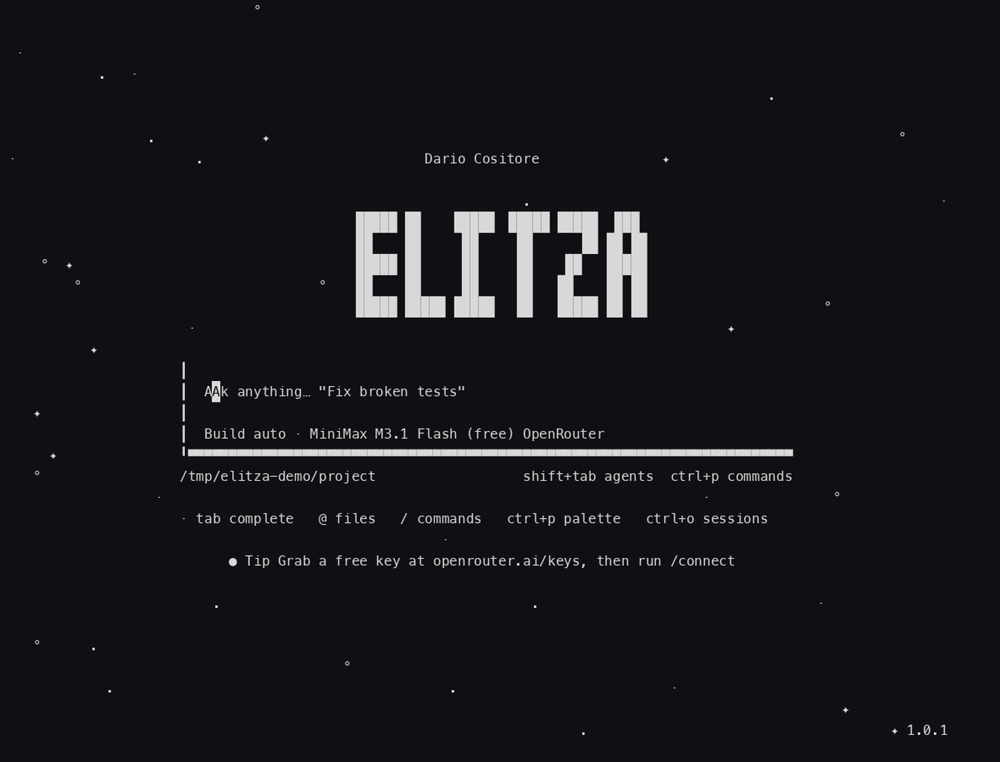
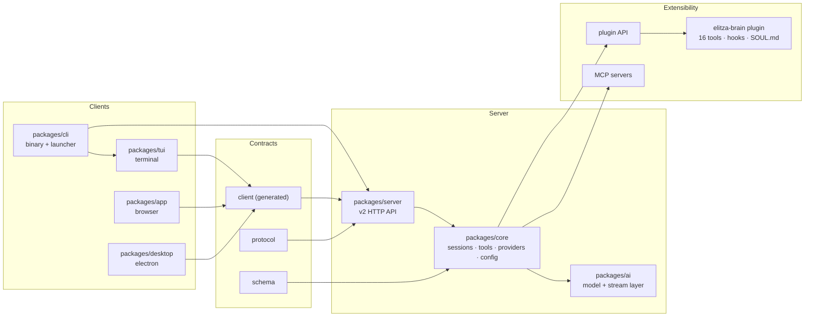

<p align="center">
  
</p>

<h1 align="center">Elitza</h1>

<p align="center">
  <b>The AI agent that grows with you.</b><br>
  Free models. Bring your own key. Her memories, her skills, her identity, all on your machine.
</p>

<p align="center">
  <a href="https://github.com/dario-cositore/elitza-code/releases"></a>
  <a href="https://github.com/dario-cositore/elitza-code/actions/workflows/check.yml"></a>
  <a href="./LICENSE"></a>
  <a href="https://bun.sh"></a>
  
  
</p>

<p align="center">
  <a href="https://elitza.life">elitza.life</a> ·
  <a href="docs/install.md">Install</a> ·
  <a href="docs/tui.md">TUI guide</a> ·
  <a href="docs/brain.md">The brain</a> ·
  <a href="docs/guided-setup.md">Guided setup</a> ·
  <a href="docs/first-client.md">First client</a> ·
  <a href="docs/handover.md">Handover</a> ·
  <a href="docs/architecture.md">Architecture</a> ·
  <a href="CONTRIBUTING.md">Contributing</a>
</p>

---

<p align="center">
  
</p>

<p align="center"><i>One prompt: validation added, an off-by-one fixed, 15 tests written and run, all on a free model.</i></p>

## What Elitza is

Elitza is an autonomous coding agent that lives in your terminal. You point it at a project, tell it what you want in plain language, and it explores the codebase, edits files, runs commands and shows you the diff. It is a full screen application with sessions, tabs, subagents, a command palette, themes and a plugin system.

Under the hood it is three things:

1. **A terminal app.** A fast, native TUI (and a browser UI and a desktop app for the same server) with real tool calling, streaming output and permission gates on every command and file write.
2. **A free, bring-your-own-key model client.** It ships with no API key and resells no inference. You connect a free OpenRouter endpoint (`:free` models) or any provider key you already own. Nothing is bundled, nothing is metered.
3. **A memory.** A SQLite brain (`soul_v2.db`) with episodic, semantic, procedural and emotional memories, personas for the people she works with, and skills she writes herself as tasks complete. Her identity lives in a plain text file you can edit.

Everything runs locally. Keys, config, sessions and memory stay under `~/.elitza`. The only outbound traffic is to the model provider you configured and to fetch update metadata.

## Highlights

**Free by design.**
`/models` lists free `:free` OpenRouter endpoints first. `/connect` walks you through adding a key you control. No subscription, no trial, no phone-home telemetry.

**A memory that compounds.**
Memories are typed (episodic, semantic, procedural, emotional), scored for importance, decayed over time and consolidated when they prove useful. Personas, roles and hooks are plain directories of JSON and markdown you can read and edit.

**She tidies up on her own.**
A heartbeat runs between conversations: it consolidates and prunes the memory database, and during a long silence she writes a reflection that is waiting in the next session's prompt. No network, no notifications, just her own files.

**Real tools, real permissions.**
Built-in tools: `read`, `write`, `edit`, `patch`, `grep`, `glob`, `shell`, `webfetch`, `websearch`, `question`, `skill`, `subagent`. Every shell command and file write can be gated by the permission policy you configure.

**Made for the terminal.**
Sessions and tabs, `@` file mentions, `/` command menu, shell mode, inline diffs with a file tree, a fuzzy command palette, theme tokens, and a storybook driven TUI test harness.

**More than a terminal.**
`elitza serve` starts the same API behind a browser UI, `elitza pair` prints one-time links to connect a browser or phone, and an Electron desktop shell renders the same app.

**Extensible.**
Plugins from npm or git, MCP servers (local and remote, with OAuth), and a plugin API for hooks, tools and TUI extensions.

## Install

macOS and Linux, x64 and arm64:

```bash
curl -fsSL https://elitza.life/install.sh | bash
```

Then start her:

```bash
elitza
```

First run teaches the rest. Type `/connect` to link a free OpenRouter key from <https://openrouter.ai/keys>, or `/models` to choose the model. Elitza never ships or embeds a key; you always bring your own.

The installer downloads a prebuilt binary plus the brain plugin, installs them at `~/.elitza/agent`, writes the `elitza` launcher into `~/.local/bin` and seeds your config, `SOUL.md` and personas. It is safe to re-run, and `--uninstall` reverses it. Full options: [docs/install.md](docs/install.md).

## Commands

| Command | What it does |
| --- | --- |
| `elitza` | Open the TUI in the current project |
| `elitza --prompt "text"` | Start a session that opens with an initial prompt |
| `elitza run "prompt"` | Run headless and print the result (`--format json`) |
| `elitza mini` | Minimal footer-only interface |
| `elitza -c` | Continue the most recent session |
| `elitza serve` | Start the v2 API and the browser UI |
| `elitza pair` | Print one-time links to connect a browser or app |
| `elitza models` | List every available model |
| `elitza auth login` | Add a provider or integration credential |
| `elitza mcp add` | Register an MCP server |
| `elitza plugin add` | Install a plugin from npm or git |
| `elitza session list` | List, export or delete sessions |
| `elitza service start` | Control the background server |
| `elitza upgrade` | Built in updater, gated off unless `ELITZA_SELF_UPDATE=1` (use the installer until then) |
| `elitza debug config` | Dump the resolved configuration |

<details>
<summary><b>Full command reference (17 subcommands)</b></summary>

| Command | Description |
| --- | --- |
| `run <message>` | One-shot non-interactive run, `--format json`, `--file`, `--model`, `--agent`, `--thinking` |
| `mini` | Minimal interactive interface |
| `serve` | v2 API + web server, `--port`, `--hostname`, `--cors`, `--service`, `--stdio` |
| `acp` | Agent Client Protocol server for editor integration |
| `api` | Send a raw request to the running server |
| `auth list\|login\|logout\|export\|import\|switch` | Credentials and BYOK integrations |
| `mcp list\|add\|auth\|logout` | MCP server management, local and remote, OAuth |
| `plugin list\|add\|check\|update\|remove` | Plugin management |
| `models` | List available models |
| `stats` | Shareable usage statistics |
| `session list\|delete\|export\|import` | Session management |
| `service start\|restart\|status\|stop\|get\|set\|unset` | Background server control |
| `pair` | One-time pairing links, `--remote` for a tunnel |
| `reload` | Reload configuration without a restart |
| `upgrade` / `uninstall` | Built in updater (needs `ELITZA_SELF_UPDATE=1`), or remove while keeping session data |
| `debug agents\|config\|paths` | Diagnostics |

Global flags: `--standalone` (private server), `--server <url>`, `--auto` (auto-approve permissions), `--session <id>`, `--continue`, `--prompt <text>`, `--log-level`, `--print-logs`, `--completions <shell>`.

</details>

## Inside the TUI

Type `/` in the composer for the command menu, `ctrl+p` for the fuzzy command palette, `@` to mention a file or skill, and `shift+tab` to cycle agents.

<details>
<summary><b>Slash commands</b></summary>

| Command | What it does |
| --- | --- |
| `/sessions` | Resume a session (aliases: `/resume`, `/continue`) |
| `/new` · `/clear` · `/rename` | Start fresh, wipe the transcript, rename the session |
| `/open` | Open a project or workspace |
| `/models` | Pick the brain, free `:free` endpoints first |
| `/connect` | Add an integration or provider key |
| `/agents` · `/variants` | Switch agent, thinking and effort variants |
| `/mcps` · `/plugins` | Manage MCP servers and plugins |
| `/diff` | Diff viewer with file tree |
| `/terminal` | Embedded terminal pane |
| `/fork` · `/timeline` · `/compact` | Branch a session, browse its timeline, compact context |
| `/undo` · `/redo` · `/copy` · `/export` | Edit history, clipboard, transcript export |
| `/cd` · `/editor` · `/worktrees` | Jump to a directory, open the editor, manage worktrees |
| `/skills` | Browse the skills she has written |
| `/themes` · `/settings` · `/status` | Theme picker, settings, runtime status |
| `/pair` | Connect a browser or phone (alias `/web`) |
| `/highlights` · `/update` · `/reload` · `/restart` | Release notes, update, reload config, restart |
| `/stats` · `/debug` · `/help` · `/exit` | Usage, diagnostics, help, quit |

</details>

<details>
<summary><b>Composer and keybindings</b></summary>

| Input | Result |
| --- | --- |
| `@name` | Mention a file, directory or skill and pull it into context |
| `/name` | Run a slash command, with fuzzy filtering |
| `!command` | Drop into shell mode and run a command inline |
| `ctrl+p` | Command palette over every command and setting |
| `ctrl+o` | Session list |
| `ctrl+x` then `l` / `n` / `m` | Switch session, new session, switch model |
| `shift+tab` | Cycle agents |
| `esc` | Interrupt a running turn, press it twice |
| `tab` | Complete a file, command or mention |

</details>

## The brain

The brain plugin (`packages/plugins/elitza-brain`) gives her a persistent self:

- **Memory.** SQLite at `~/.elitza/brain/soul_v2.db`. Episodic (episodes, 1000 max), semantic (facts, 500), procedural (skills, 200) and emotional (300) memories, plus a full text index, a recall log and a session log. Memories carry importance and valence, decay on a schedule, and get consolidated when they cross the threshold.
- **Identity.** `~/.elitza/SOUL.md` is her core personality in plain markdown. Edit it and she changes.
- **Personas, roles and hooks.** Directories of JSON and markdown under `~/.elitza` for who she is talking to, how she should behave, and what she should do on an event.
- **Skills.** Markdown in `~/.elitza/brain/procedural`, written by herself as tasks complete and replayed as procedures on later tasks.
- **16 brain tools** exposed to the model: `brain_search`, `brain_create`, `brain_stats`, `brain_consolidate`, `brain_forget`, `brain_personality`, `brain_metamemory`, `brain_learning`, `brain_persistence`, `brain_search_history`, `brain_sessions`, `brain_config`, `brain_validate`, plus `doctor_check`, `doctor_repair` and `doctor_history` for self-repair.

Full reference: [docs/brain.md](docs/brain.md).

## Where things live

| Path | What lives there |
| --- | --- |
| `~/.elitza/agent` | The installed release (binary + brain plugin) |
| `~/.elitza/brain/soul_v2.db` | Memories, links, recall log, session log |
| `~/.elitza/SOUL.md` | Her identity. Edit to make her yours |
| `~/.elitza/personas`, `roles`, `hooks` | Persona, role and hook definitions |
| `~/.elitza/home/config` | Installed config (`opencode.json`) and service credential |
| `~/.elitza/home/data/elitza.db` | Session database for the installed copy |
| `~/.elitza/.env` | Provider keys, loaded by the launcher |
| `./elitza.json`, `./.elitza/` | Per project configuration |

## Architecture



Three clients (terminal, browser, desktop) talk to one server. The server owns sessions, tools, providers and configuration, and plugins hang off the same host. Detailed package map and request flow: [docs/architecture.md](docs/architecture.md).

## Development

Requires [Bun](https://bun.sh) 1.4.2 or newer.

```bash
git clone https://github.com/dario-cositore/elitza-code
cd elitza-code
bun install
bun run dev        # run the TUI from source
bun run check      # lint + typecheck, run from the repo root
```

Tests run per package, never from the root: `cd packages/tui && bun test`. CI runs `bun run check`, `bun turbo test --affected`, a CLI build and a service smoke test on every push. Releases are built for linux x64/arm64 and darwin x64/arm64 when a `v*` tag lands.

More detail in [docs/configuration.md](docs/configuration.md) and [CONTRIBUTING.md](CONTRIBUTING.md).

## FAQ

<details>
<summary><b>Is it really free?</b></summary>

The software is MIT licensed and costs nothing. Inference is either a free `:free` OpenRouter endpoint or a key you already own. Elitza ships with no key of its own and resells no tokens. You can use it fully offline against a local model endpoint if you configure one.
</details>

<details>
<summary><b>Where does my data go?</b></summary>

Nowhere but your machine. Keys, config, sessions and memory live under `~/.elitza`. The only outbound connections are to the model provider you configured and to release metadata when you install or update. There is no analytics or telemetry client in the tree.
</details>

<details>
<summary><b>What is Elitza built on?</b></summary>

Elitza is a fork of the [OpenCode](https://github.com/anomalyco/opencode) terminal agent, rebranded and reworked end to end for a free model, bring-your-own-key life: new brain plugin, new identity system, new defaults, new installer and a rebuilt command surface. Upstream credit stays in the license and in this sentence.
</details>

<details>
<summary><b>Can I use it with my own models?</b></summary>

Yes. `/connect` and `elitza auth login` accept any OpenAI-compatible provider. `/models` shows every model the configured providers expose, free endpoints first, and `shift+tab` or `ctrl+x` then `m` switches models mid session.
</details>

<details>
<summary><b>Windows?</b></summary>

The build pipeline can produce windows binaries, but only macOS and Linux are built and smoke tested in CI today. Track it in issues.
</details>

## Contributing

Bug fixes, free model and BYOK improvements, brain improvements, and documentation are the changes most likely to land. Read [CONTRIBUTING.md](CONTRIBUTING.md) for the ground rules and [AGENTS.md](AGENTS.md) for the repository conventions.

Security reports go through [GitHub Security Advisories](https://github.com/dario-cositore/elitza-code/security/advisories), never through public issues. See [SECURITY.md](SECURITY.md).

## Heritage and license

Elitza is a fork of [OpenCode](https://github.com/anomalyco/opencode), rebranded and reworked by Dario Cositore. Licensed under the MIT License, see [LICENSE](./LICENSE). Elitza branding and product design are separate from the upstream project.

<p align="center">
  <a href="https://elitza.life"><b>elitza.life</b></a> ·
  
</p>
