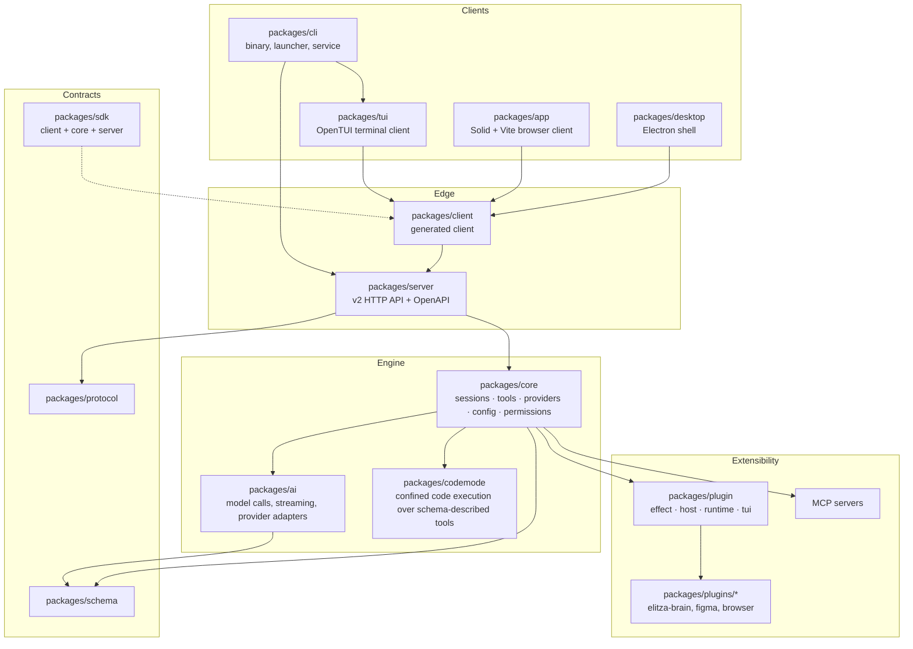
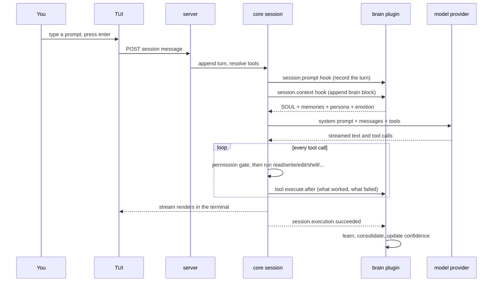

# Architecture

Elitza is a Bun and TypeScript monorepo: one server that owns sessions, tools and models, and three clients (terminal, browser, desktop) that talk to it over the same API. Plugins hang off the server host, and the brain is one of them.

Back to the [README](../README.md). See also [the brain](brain.md) and [configuration](configuration.md).

## The shape of the system

## Dependency rules

These are enforced by review and by lint (`AGENTS.md`):

1. Runtime dependencies point from `schema` to `core` and `protocol`, then from `core` and `protocol` to `server`.
2. `client` runtime code may depend on `schema` and `protocol`, never on `core` or `server`.
3. `sdk` is the one place that composes `client`, `core` and `server`.
4. Regenerate the client after changing the public API: `cd packages/client && bun run generate`. Generated files are never edited by hand.

The contracts are the boundary. A client can be written in any language that can speak the v2 API, which is exactly what the browser app and the Electron shell do.

## What one turn looks like

The brain block is marked with `<!-- elitza-brain -->` so it is only ever injected once per request. The event stream, not a timer, is what drives the post turn work.

## Package map

| Group | Packages | Role |
| --- | --- | --- |
| Clients | `cli`, `tui`, `app`, `desktop`, `session-ui`, `ui`, `theme` | Everything a human touches |
| Engine | `core`, `ai`, `codemode`, `simulation` | Sessions, tools, model calls, replayable simulation |
| Edge | `server`, `client`, `sdk`, `protocol`, `schema` | API surface and the generated client |
| Extensibility | `plugin`, `plugins/*`, `plugin-browser` | Plugin host and the shipped plugins |
| Support | `util`, `identity`, `latex`, `merman`, `containers`, `httpapi-codegen`, `http-recorder`, `storybook`, `script`, `function`, `gui-extensions` | Shared helpers, codegen, tests |

Only a few of these are published; most are internal to the monorepo. `desktop`, `function`, `gui-extensions`, `session-ui`, `storybook` and `tui` are marked private.

## Built in tools

`packages/core/src/tool/plugin/` registers the tool surface every session gets:

`read`, `write`, `edit`, `patch`, `grep`, `glob`, `shell`, `webfetch`, `websearch`, `question`, `skill`, `subagent`.

Plugins add more. The brain plugin registers its sixteen memory tools as direct model tools (not behind the code mode catalog), which is why they appear in the model request alongside the core set.

Permission policy decides which of these run automatically and which prompt you. See [configuration](configuration.md).

## The three interfaces

| Interface | Package | Notes |
| --- | --- | --- |
| Terminal | `packages/tui` | OpenTUI based, sessions and tabs, storybook driven frame tests |
| Browser | `packages/app` | Solid, Vite, PWA; built assets are embedded in the binary and served by `packages/cli/src/services/web-ui.ts` |
| Desktop | `packages/desktop` | Electron shell rendering `packages/app`, private package |

`elitza serve` starts the API and web server on its own, `elitza pair` prints one time links for another device, and the plain `elitza` command launches the terminal client against a background service.

## Configuration resolution

Config is discovered from, in order of specificity: `elitza.json(c)` or `opencode.json(c)` in the working directory, project level directories (`.elitza`, `.claude`, `.agents`, `.opencode`), the global XDG config directory (overridable with `OPENCODE_CONFIG_DIR`), then system directories (`/etc/opencode`, `/Library/Application Support/opencode`, `%ProgramData%/opencode`). Full detail in [configuration](configuration.md).

## Build, test and release

| Piece | Where | Runs |
| --- | --- | --- |
| Static checks | `.github/workflows/check.yml` | `bun run check`, lint of changed GUI files on PRs |
| Tests and build | `.github/workflows/test.yml` | Effect lint rules, `bun turbo test --affected`, generated client check, CLI build plus a service smoke test, app build |
| Releases | `.github/workflows/release.yml` | On `v*` tags: four target builds, version smoke test, bundle binary plus the brain plugin, publish the release |
| Targets | `packages/cli/script/build.ts` | linux x64, linux arm64, darwin arm64, darwin x64 (what CI builds and tests) |

Local equivalents: `bun run check` from the root, `bun test` inside a package directory.

## See also

* [README](../README.md)
* [The brain](brain.md): the plugin that gives her memory
* [Configuration](configuration.md): model, provider, permission and plugin settings
* [CONTRIBUTING.md](../CONTRIBUTING.md): branch, commit and PR conventions
