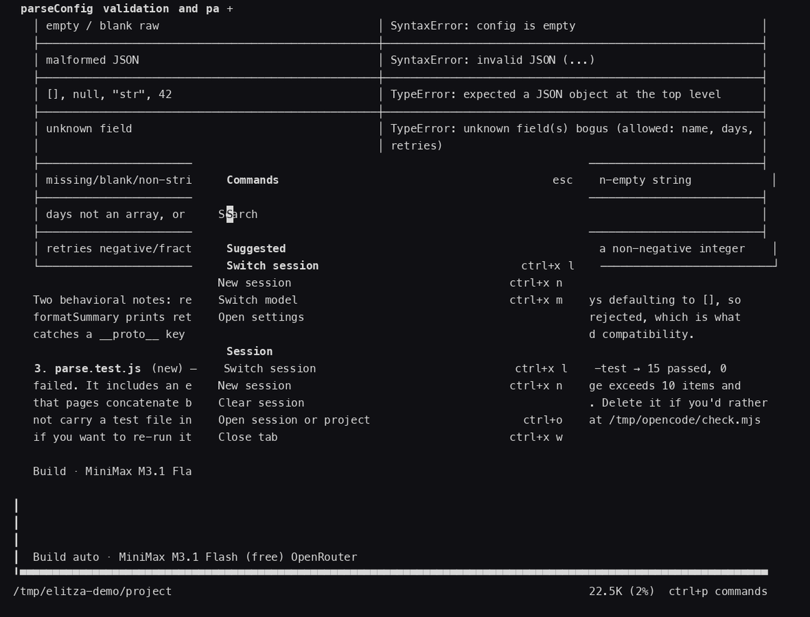
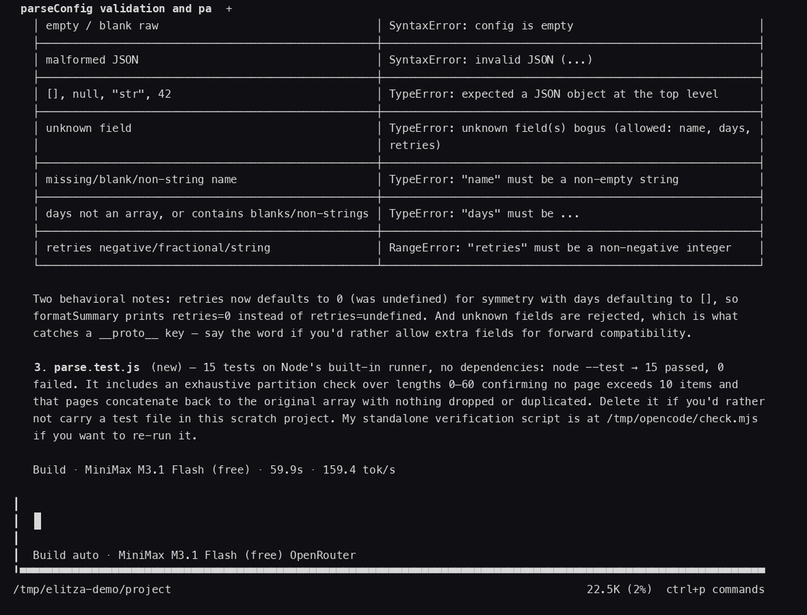

# TUI guide

Elitza's terminal app is built around one composer and one command surface. You get sessions, tabs, mentions, slash commands, a fuzzy palette and inline diffs, all from the same input. The [README](../README.md#inside-the-tui) lists the highlights; this page documents every command, keybinding and screen.

  

  

## The composer

The composer is the input at the bottom of the screen. Everything starts there.

| You type | You get |
| --- | --- |
| `@name` | Mention a file, directory, skill, agent or reference and pull it into context (`packages/tui/src/prompt/display.ts`, `packages/tui/src/component/prompt/autocomplete.tsx`) |
| `/name` | The slash command menu, with fuzzy filtering |
| `!command` | Shell mode, from an empty composer with the cursor at the start: your line runs as a shell command instead of a prompt (`packages/tui/src/component/prompt/index.tsx:975`) |
| `tab` | Complete the suggestion under the cursor |
| `return` | Accept the highlighted suggestion, or send the prompt |
| `up` / `down` | Move through suggestions, then through prompt history |
| `esc` | Hide the suggestion menu, leave shell mode, or interrupt a running turn |

Shell mode has its own exits: `esc`, `backspace` on an empty line, or `ctrl+c` on an empty line. The composer border and footer switch to the shell color while you are in it.

## Interrupting a turn

Press `esc` while a turn is running. The footer hint reads `esc interrupt`, then flips to `esc again to interrupt`. The second press, within five seconds, stops the turn and leaves the session resumable (`packages/tui/src/component/prompt/index.tsx`, binding in `packages/tui/src/config/keybind.ts`).

## The command palette

Press `ctrl+p`. The dialog is titled **Commands** (`packages/tui/src/component/command-palette.tsx`) and it is opened by the `command.palette.show` command (`packages/tui/src/context/keymap.tsx:53`). It fuzzy-searches every palette-visible command, sorted into categories with their keybinding in the footer, plus every entry from the settings dialog. Suggested commands float to the top while the filter is empty.

The prompt footer advertises it as `ctrl+p commands` (`packages/tui/src/feature-plugins/prompt/footer.tsx`). `ctrl+o` opens recent sessions and projects instead.

## Keybindings

`ctrl+x` is the leader key: hold it, then press the second key. All defaults live in `packages/tui/src/config/keybind.ts` (the leader itself is defined at `packages/tui/src/config/keybind.ts:41`).

| Keys | What they do |
| --- | --- |
| `ctrl+p` | Command palette |
| `ctrl+o` | Recent sessions and projects |
| `ctrl+x` `l` | Switch session |
| `ctrl+x` `n` | New session |
| `ctrl+x` `m` | Switch model |
| `ctrl+x` `enter` | Queue the prompt instead of sending it |
| `ctrl+x` `y` | Copy the last assistant message |
| `ctrl+x` `c` | Compact the session |
| `ctrl+x` `g` | Session timeline |
| `ctrl+x` `w` | Close the current tab |
| `shift+tab` | Next agent |
| `ctrl+tab` / `ctrl+shift+tab` | Next / previous tab |
| `ctrl+shift+t` | Reopen the closed tab |
| `ctrl+r` | Rename the session |
| `esc` | Interrupt a running turn (press it twice) |

Tabs also have quick slots: `ctrl+1` through `ctrl+0` jump to a tab, `ctrl+x` `1` through `ctrl+x` `9` jump to a session quick slot (`packages/tui/src/app.tsx`).

## Slash commands

Type `/` in the composer. Type `/` then a name to filter. Full list with aliases:

<b>Sessions and history</b>

| Command | What it does |
| --- | --- |
| `/sessions` (aliases: `/resume`, `/continue`) | Open the session list and resume one (`packages/tui/src/component/dialog-session-list.tsx`) |
| `/new` | Start a new session, keeping your current model and agent |
| `/clear` | Leave the current transcript and open a fresh session |
| `/open` (aliases: `/projects`, `/project`) | Open a session, project or worktree |
| `/rename [title]` | Rename the session, or regenerate the title with no argument |
| `/timeline` | Jump to any message in the transcript |
| `/fork` | Branch the session from an earlier message |
| `/compact` | Compact the conversation context with the current model |
| `/undo` | Pull your last user message back into the composer |
| `/redo` | Restore the message you undid |
| `/copy` | Copy the whole transcript to the clipboard |
| `/export` | Export the transcript as markdown or JSON, to clipboard or file |
| `/btw <question>` | Ask a side question from the session's context without adding it to the conversation (`packages/tui/src/feature-plugins/prompt/btw.tsx`) |

<b>Models, agents and extensions</b>

| Command | What it does |
| --- | --- |
| `/models` | Model picker, free `:free` endpoints first |
| `/agents` | Switch agent |
| `/variants` (aliases: `/thinking`, `/effort`) | Pick the thinking or effort variant of the current model |
| `/connect` | Add a provider or integration key |
| `/mcps` | Manage MCP servers |
| `/plugins` | Manage plugins |
| `/skills` | Browse her skills and insert one into the composer with `@` |

<b>Files and navigation</b>

| Command | What it does |
| --- | --- |
| `/cd <path>` | Move the session to another directory (`packages/tui/src/component/prompt/index.tsx`) |
| `/editor` | Open the composer text in an editor and bring the result back |
| `/worktrees` | List, create and delete worktrees for the project |
| `/terminal` | Open a new embedded terminal pane |
| `/diff` | Diff viewer with a file tree (`packages/tui/src/feature-plugins/system/diff-viewer.tsx`) |

<b>Appearance</b>

| Command | What it does |
| --- | --- |
| `/themes` | Theme picker over every installed theme |
| `/settings` | Settings dialog |

<b>Maintenance and system</b>

| Command | What it does |
| --- | --- |
| `/status` | Runtime status dialog |
| `/update` | Open the update dialog when one is offered |
| `/reload` | Reload configuration without restarting |
| `/restart` | Restart the background service |
| `/debug` | Debug info dialog |
| `/highlights` | Release highlights, only when the current release has any |
| `/pair` (alias: `/web`) | One-time links to connect a browser or phone |
| `/stats` | Usage statistics |
| `/help` | Help dialog |
| `/exit` (aliases: `/quit`, `/q`) | Quit |

Command definitions live in `packages/tui/src/app.tsx`, `packages/tui/src/routes/session/index.tsx` and `packages/tui/src/component/prompt/index.tsx`, plus the plugin commands for `/diff`, `/terminal`, `/stats`, `/plugins` and `/btw`.

## Session lifecycle

1. **Open.** Run `elitza` in a project. The home screen shows the tips and the key hints: `tab` complete, `@` files, `/` commands, `ctrl+p` palette, `ctrl+o` sessions (`packages/tui/src/routes/home.tsx`).
2. **Mention a file.** Type `@`, pick the file, keep typing your request. The file lands in the prompt as a mention, not as pasted text.
3. **Run a command inline.** Press `!` in the empty composer, type `git status`, hit return. The line runs as a shell command and you stay in the same screen.
4. **Review the diff.** Edits come back inline in the transcript: `← Edit`, `# Created` and `# Patched` blocks with added and removed lines side by side (`packages/tui/src/routes/session/index.tsx`). Wider terminals split the view, narrow ones go unified.
5. **Interrupt.** Press `esc` twice to stop a turn that is going the wrong way. The composer keeps your text.
6. **Come back later.** `ctrl+o` lists recent sessions, `/sessions` opens the full list, and `ctrl+x` `l` jumps to another one. `/diff` reopens the change review with the file tree whenever you need it.

## Themes

`/themes` opens a picker over every theme on disk. Themes are JSON files with semantic tokens: `packages/tui/src/theme/assets/*.json` holds the built-in set (catppuccin, dracula, gruvbox, nord, tokyonight, one-dark and more), `packages/tui/src/theme/v1.ts` defines the token surface, and `packages/theme` owns the schema and resolution.

The brand color is orange. The built-in `elitza` theme maps its dark primary to an orange step, and `orng` goes all in on orange (`packages/tui/src/theme/assets/elitza.json`, `packages/tui/src/theme/assets/orng.json`).

## See also

- [Install](install.md): installer flags, launcher paths, first run
- [Configuration](configuration.md): config files, keybind overrides, themes on disk
- [README: Inside the TUI](../README.md#inside-the-tui), [README: Commands](../README.md#commands)
